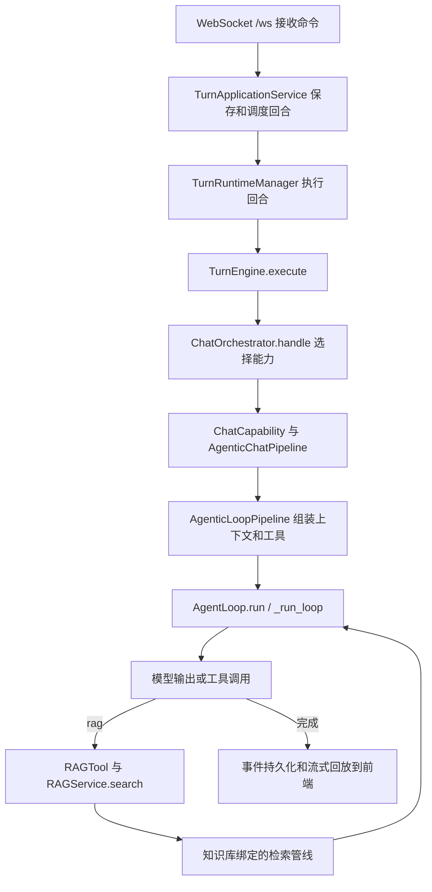

# DeepTutor 1.6.15 第一阶段源码阅读路线

源码目录：`<DeepTutor源码目录>`。固定提交 `a31d82624c27d75f4e771d4fcb78dce16470b383`。本次 Git 连接不可用，使用官方 codeload 提交快照，校验值见同目录的 `源码版本.json`。这是源码静态分析起点，不代表用户已完成阅读或模型执行测试。

## 从一条数据结构问答开始

假设用户选择“数据结构_第1章_绪论”并提问“原地工作是否不使用任何额外空间”。系统需要传递会话和知识库选择、调用模型、检索课件第65页，再返回引用和解释。

这是一张简化职责图。实际还有账号与工作区访问检查、回合运行时和事件存储，不应将 WebSocket 当成直接调用模型的接口。

## 推荐阅读顺序

| 顺序 | 源码 | 核心问题 |
| --- | --- | --- |
| 1 | `deeptutor/api/routers/unified_ws.py`，`unified_websocket` | 前端发送怎样的开始/订阅/取消命令？ |
| 2 | `deeptutor/app/service.py`，`TurnApplicationService.start_turn` | 回合如何持久化、调度和去重？ |
| 3 | `deeptutor/runtime/turn_engine.py`，`TurnEngine.execute` | 不同入口如何汇合到共享执行引擎？ |
| 4 | `deeptutor/runtime/orchestrator.py`，`ChatOrchestrator.handle` | 如何选择能力、管理流和完成状态？ |
| 5 | `deeptutor/agents/chat/agentic_pipeline.py` | 为什么这个聊天绑定类很短？ |
| 6 | `deeptutor/agents/loop/pipeline.py`，`AgenticLoopPipeline.run` | 模型、提示词、历史、预算和工具如何组装？ |
| 7 | `deeptutor/agents/loop/agent_loop.py`，`AgentLoop.run`、`_run_loop`、`_call_llm` | 本版本聊天具体怎样循环调用模型和工具？ |
| 8 | `deeptutor/tools/builtin/__init__.py`，`RAGTool` | 模型的rag参数怎样变成真实检索调用？ |
| 9 | `deeptutor/services/rag/service.py`，`RAGService.search` | 如何选择当前知识库绑定的检索引擎和Embedding？ |
| 10 | `deeptutor/services/rag/pipelines/llamaindex/` | 索引、检索及引用结果如何构造？ |

注意：仓库中另有 `deeptutor/runtime/agentic/loop.py` 标签协议调度器。分析当前聊天路径时，应先跟踪实际实例化的 `AgentLoop`，不要看到一个名为loop的文件就认定它是当前路径唯一入口。

## 上传与索引流程

从 `deeptutor/api/routers/knowledge.py` 的 `create_knowledge_base` 和 `_create_knowledge_base_owned` 开始，依次观察：知识库命名与权限、引擎与Embedding选择、上传批次校验、任务状态注册、资料保存、后台初始化。后续新增资料走同文件的upload接口。

再读 `deeptutor/knowledge/initializer.py` 的 `KnowledgeBaseInitializer`，以及 `deeptutor/services/rag/service.py` 中的 `initialize`/`_index`。原文保存、解析成功、索引发布和可检索是不同阶段，测试应记录阶段状态，不能只凭raw目录已有文件判断完成。

命令行的 `deeptutor_cli/kb.py` 通过相同知识库初始化/增量添加服务管理资料；本实践的入库脚本调用此受支持CLI，不直接篡改索引目录。

## 用户需要亲自完成的两个练习

1. 用一张纸画出“用户问题、模型、rag工具、检索结果、最终回答”的关系，指认各自对应的文件。说明模型为什么需要检索结果，而不是只接收一个PDF路径。
2. 模型配置并入库后，对第65页提出上述问题。在日志或调试器中核对：选中的知识库、检索参数、返回的资料片段、模型最终引用。记录真实结果，不把本静态分析冒充运行证据。

最小工程任务建议：使用现有 `kb eval` 运行候选题集，人工检查三道失败或边界问题，再决定是否需要修改检索设置或代码。当前尚未实施模型调用或修改上游业务代码。
