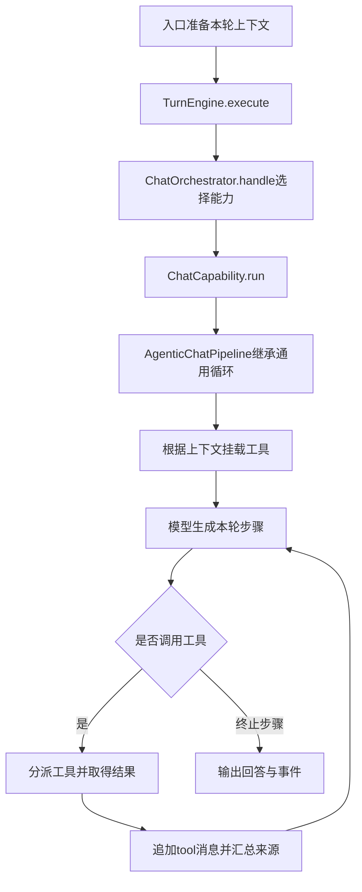

# DeepTutor Agent调用链：前三章课程使用的静态阅读笔记

阅读日期2026-10-25；源码仓库：https://github.com/HKUDS/DeepTutor。
实际检出提交：`a31d82624c27d75f4e771d4fcb78dce16470b383`。
状态：已阅读下列代码。未安装运行依赖、未配置模型、未执行实际问答、未取得运行轨迹。以下流程是静态代码分析，不能写成端到端实验已跑通。

## 从提问到工具结果回填

以“请结合本章解释条件概率与独立性的区别”为后续演示题。实际调用哪些工具由上下文、能力、知识库类型与模型决定，不保证每轮必定触发检索。

## 实际阅读的代码定位

链接均固定到已检出的提交，便于避免主分支后续变动。

1. [执行引擎](https://github.com/HKUDS/DeepTutor/blob/a31d82624c27d75f4e771d4fcb78dce16470b383/deeptutor/runtime/turn_engine.py)：`TurnEngine.execute`延迟导入编排器，再转发`handle(context)`产生的流事件。
2. [能力编排](https://github.com/HKUDS/DeepTutor/blob/a31d82624c27d75f4e771d4fcb78dce16470b383/deeptutor/runtime/orchestrator.py)：`ChatOrchestrator.handle`按`context.active_capability`选能力，未指定时使用chat；未知能力走错误与完成事件，正常执行交给`capability.run`。
3. [聊天能力](https://github.com/HKUDS/DeepTutor/blob/a31d82624c27d75f4e771d4fcb78dce16470b383/deeptutor/agents/chat/capability.py)：`ChatCapability.run`构造聊天流水线并运行。能力层与具体工具的单次执行不是同一层。
4. [聊天流水线](https://github.com/HKUDS/DeepTutor/blob/a31d82624c27d75f4e771d4fcb78dce16470b383/deeptutor/agents/chat/agentic_pipeline.py)：`AgenticChatPipeline`继承`AgenticLoopPipeline`，实际公共逻辑在[通用流水线](https://github.com/HKUDS/DeepTutor/blob/a31d82624c27d75f4e771d4fcb78dce16470b383/deeptutor/agents/loop/pipeline.py)。后者的`run`会组合工具，不能只看一个很短的子类就断言没有Agent循环。
5. [工具挂载规则](https://github.com/HKUDS/DeepTutor/blob/a31d82624c27d75f4e771d4fcb78dce16470b383/deeptutor/agents/_shared/tool_composition.py)：`compose_enabled_tools`与`ToolMountFlags`根据上下文决定工具表。常规RAG的has_kb条件由流水线计算。PageIndex等知识库可能使用自身工具，不能说所有知识库必经同名rag工具。
6. [循环内核](https://github.com/HKUDS/DeepTutor/blob/a31d82624c27d75f4e771d4fcb78dce16470b383/deeptutor/runtime/agentic/loop.py)：`run_agentic_loop`区分终止步骤、工具步骤和中间步骤。工具步骤先追加含工具调用的assistant消息，再执行分派，将`outcome.tool_messages`扩展进消息历史，随后继续循环。内核还设置迭代预算并处理协议不合规、暂停与终止情形。
7. [工具结果组装](https://github.com/HKUDS/DeepTutor/blob/a31d82624c27d75f4e771d4fcb78dce16470b383/deeptutor/runtime/agentic/tool_dispatch.py)：`_collect_outcome`发出tool_result事件、汇总来源，并构造带`role=tool`和`tool_call_id`的消息。界面显示工具输出和下一轮模型收到工具输出是相关但不同的动作。
8. [常规RAG包装](https://github.com/HKUDS/DeepTutor/blob/a31d82624c27d75f4e771d4fcb78dce16470b383/deeptutor/tools/rag_tool.py)：`rag_search`检查非空query与明确kb_name，解析访问范围，再调用`RAGService.search`。仅仅把文本放进某个文件夹不等于完成知识库初始化与检索。

## 对概率论课程的实际启示

知识库提供的是可引用材料；模型是否正确使用公式还需要单独验证。资料中应保留参数、独立条件、支持区域和原创题目ID，使工具返回的片段足以支持推导。

题量统计必须预先由完整索引生成。RAG只取部分片段，模型看到几道题并不能证明整章只有几道。各章导航因此把统计口径和数量放在一起。

即使每个工具都返回成功，也需要核查最终答案有没有漏条件，例如把N(10,4)的方差当标准差，或在三角区域内误判独立。调用成功与学习结果正确应分别记录。

## 后续真实实验需要补的证据

配置完成后选一道验证题，保留输入、所选知识库、工具调用参数、检索来源、tool_result、最终答案及人工核对结果。再设计一题资料不足的问题，检查是否明确承认缺少原题。

本轮未执行这些步骤，没有编造耗时、费用、检索准确率或学习提升。
